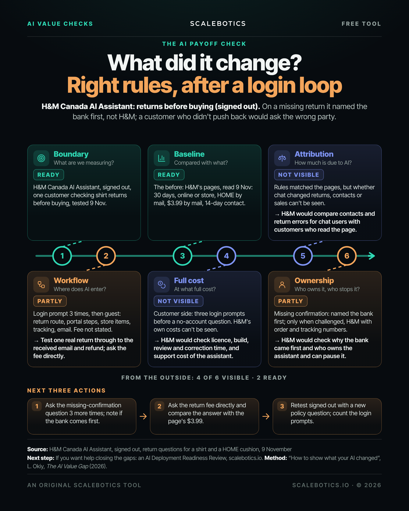
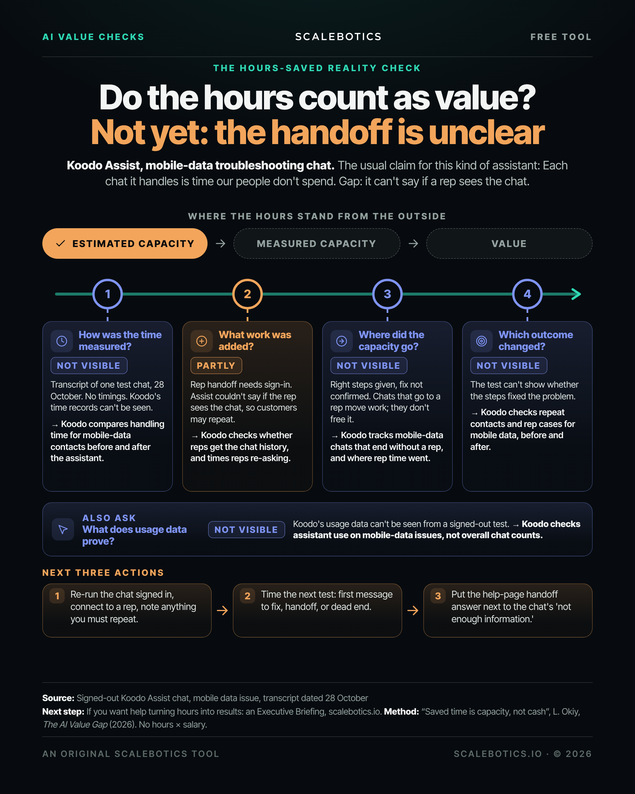

# AI Value Checks

**Can you prove your AI paid off?** Two free tools that tell you in five minutes, and show you exactly what's missing.

Free Claude skills that check one AI use, or one AI claim, on your own case. Each one gives you the answer first, in plain words, then a one-page result you can take to your next budget meeting.

They don't calculate a return on investment. They use only the numbers you give them, and check whether those numbers will hold up.

| | Check | The question it answers | You get |
|---|---|---|---|
| 1 | **The AI Payoff Check** | What did your AI change, compared with what, and who owns the next step? | Your value record: six parts, each Ready, Partly, Missing (or Not visible from the outside), and the one question that closes each gap |
| 2 | **The Hours-Saved Reality Check** | Your AI saves hours. Do they count as value? | What the hours are today (estimated capacity, measured capacity, or value), four questions and the usage question, each Ready, Partly, Missing (or Not visible from the outside) |

More checks follow, numbered in order of release.

▶ **See them run:** [AI Payoff Check video](https://klzxpnznetqcqwcucdpx.supabase.co/storage/v1/object/public/distribution-media/wk47/dcc9ddb436e5122e/The-AI-Payoff-Check-HM-Canada.mp4) · [Hours-Saved Reality Check video](https://klzxpnznetqcqwcucdpx.supabase.co/storage/v1/object/public/distribution-media/wk47/d0cb136e8ca19224/AI-Value-Checks-02-saved-time-check.mp4)

## How to use a check
The checks run in Claude wherever skills are available.

**In Claude (claude.ai):** download the check's `SKILL.md`, then add it as a skill in Claude's settings. Start a chat and describe one AI use.

**In Claude Code:** copy the check's folder into `.claude/skills/` in your project (for example `.claude/skills/ai-payoff-check/SKILL.md`). Then ask, for example, "Run the AI Payoff Check on our support assistant."

The check asks only for what is missing, in one short message. "We don't know" is a fine answer: it shows up as a gap, not a failure. You don't need to share personal or confidential data; descriptions are enough.

**The one-page result (optional):** ask for the one-page record at the end. The check returns a short block of data; `render.py` turns it into a 1080×1350 page:

```
python3 01-ai-payoff-check/render.py my-record.json my-record.html
```

Open the HTML in a browser, or screenshot it.

## Examples: real runs on real assistants
Each check was run on one of our public, signed-out tests in *The State of AI Agent Value* of a real customer-facing AI assistant. The transcripts are the real runs, word for word; the user's turns use only the facts and quotes from the test.

| Check | Case | Answer | Files |
|---|---|---|---|
| AI Payoff Check | H&M Canada AI Assistant, tested 9 Nov 2026 | Right rules, after a login loop | `01-ai-payoff-check/examples/hm-canada-returns.*` |
| Hours-Saved Reality Check | Koodo Mobile · Koodo Assist, tested 28 Oct 2026 | Not yet: the handoff is unclear | `02-hours-saved-reality-check/examples/koodo-assist-handoff.*` |

Each check also works from the outside: when you test a company's public assistant, what the test can't show is marked **Not visible**, never Missing.

**Watch each check run (about 40 seconds each; replies sped up, words unchanged):**
- ▶ [The AI Payoff Check on H&M Canada](https://klzxpnznetqcqwcucdpx.supabase.co/storage/v1/object/public/distribution-media/wk47/dcc9ddb436e5122e/The-AI-Payoff-Check-HM-Canada.mp4)
- ▶ [The Hours-Saved Reality Check on Koodo Assist](https://klzxpnznetqcqwcucdpx.supabase.co/storage/v1/object/public/distribution-media/wk47/d0cb136e8ca19224/AI-Value-Checks-02-saved-time-check.mp4)

(The same videos are in the `videos/` folder.)

| The AI Payoff Check | The Hours-Saved Reality Check |
|---|---|
|  |  |

## Where the checks come from
The method is from *The AI Value Gap* (L. Okiy, 2026): The AI Payoff Check from "How to show what your AI changed", The Hours-Saved Reality Check from "Saved time is capacity, not cash". The checks are written and kept by Scalebotics.

## Licence
Free to use, share and adapt, including at work, with attribution, under the Creative Commons Attribution 4.0 licence (CC BY 4.0). Credit it as:

> *The AI Payoff Check* (or *The Hours-Saved Reality Check*), AI Value Checks, by Scalebotics, scalebotics.io

## Want help with what a check finds?
Each check ends with one line naming the matching next step: an AI Deployment Readiness Review (The AI Payoff Check) or an Executive Briefing (The Hours-Saved Reality Check). Details at scalebotics.io.
